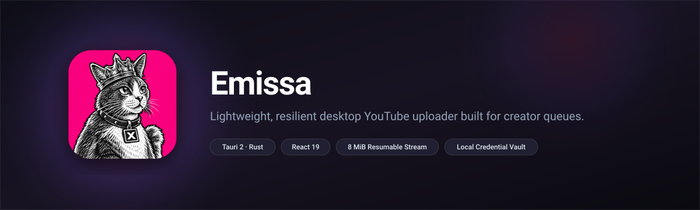
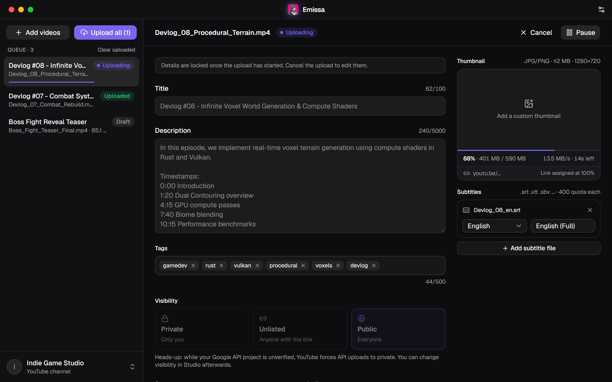
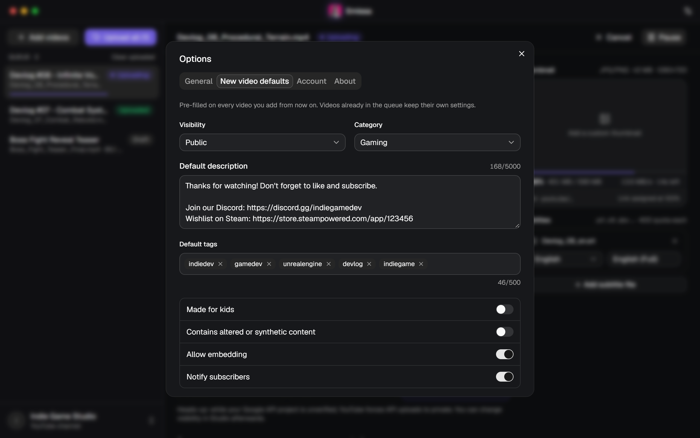
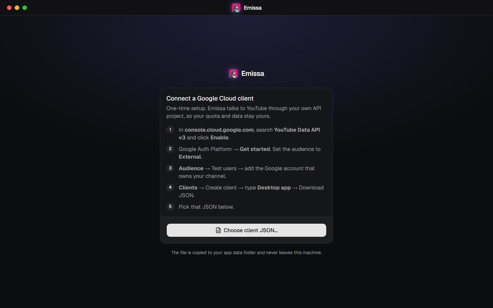
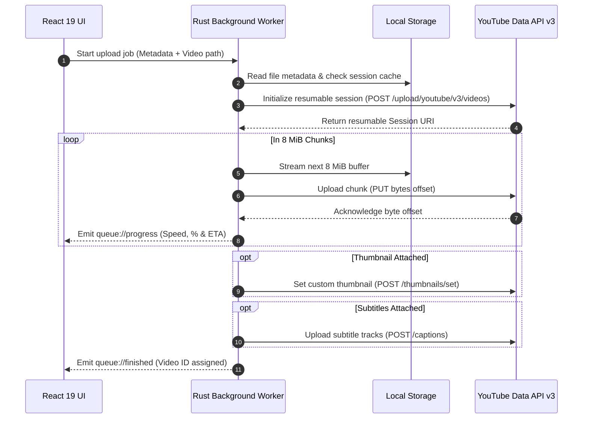

<div align="center">


# Emissa

**Lightweight, crash-resilient desktop YouTube uploader built for creator queues.**

[](https://v2.tauri.app)
[](https://www.rust-lang.org)
[](https://react.dev)
[](https://tailwindcss.com)
[](#)

</div>

<p align="center">
  
</p>

<p align="center">
  <a href="#about">About</a> •
  <a href="#features">Features</a> •
  <a href="#screenshots">Screenshots</a> •
  <a href="#how-it-works">How It Works</a> •
  <a href="#prerequisites--setup">Prerequisites & Setup</a> •
  <a href="#building-from-source">Building from Source</a> •
  <a href="#known-quota-limits">Known Quota Limits</a>
</p>

---

## About

**Emissa** (from *emissary* — carrying your videos off for you) is a lightweight desktop utility engineered for batch uploading video files directly to your own YouTube channel. Built on Tauri 2, Rust, and React 19, it replaces cumbersome browser tabs with a reliable, standalone desktop client.

Instead of buffering large videos into system memory, Emissa streams files directly from disk in 8 MiB chunks using YouTube's resumable upload protocol. Designed specifically for video editors, animators, and game developers working with large render queues, uploads automatically pause, resume, handle network interruptions with backoff, and persist state safely across app restarts.

## Features

- **Chunked Resumable Uploads**: Streams videos from disk in 8 MiB slices via YouTube Data API v3. Upload sessions persist locally so jobs survive network drops, computer sleep, or app restarts.
- **Batch Queue Management**: Drag and drop batches of video files into the sidebar. Track upload status, speed (MB/s), and real-time progress bars per job, or initiate an automated "Upload all" queue run.
- **Comprehensive Metadata Editor**: Edit titles, descriptions, comma-separated tags, category selection, publishing privacy (`Private`, `Unlisted`, `Public`), `Made for Kids` compliance flags, and synthetic/AI-altered media disclosures.
- **Thumbnail & Caption Processing**: Attach custom thumbnail files (`JPG`/`PNG` under 2 MB) and attach localized subtitle tracks (`.srt`, `.vtt`, `.sbv`) directly within the upload pipeline.
- **Zero-Cloud Local Credential Security**: Communicates directly between your computer and Google through your own Google Cloud OAuth desktop credentials. Refresh tokens are secured in the Windows Credential Manager (`keyring`), and configuration files stay local in `%APPDATA%\com.yutub.app`.
- **Reusable Default Templates**: Configure default description footers, tags, and category presets in Options so newly queued items are pre-populated instantly.

## Screenshots

<p align="center">
  
  <br /><em>Dashboard: Batch queue management with active 8 MiB chunk streaming, live upload speeds, and complete YouTube metadata editing.</em>
</p>

<p align="center">
  
  <br /><em>Preferences: Global presets for channel defaults, automated tagging, description templates, and system tray integration.</em>
</p>

<p align="center">
  
  <br /><em>First-Run Setup: Step-by-step guidance for connecting your personal Google Cloud desktop client without third-party servers.</em>
</p>

## How It Works

Emissa executes a native background upload pipeline managed entirely in Rust (`tokio` async tasks) while keeping the frontend reactive and responsive.



1. **Session Handshake**: The worker sends video metadata to YouTube's resumable endpoint to obtain an upload session URI, which is saved to `queue.json`.
2. **Streaming Execution**: Files are read from disk in 8 MiB segments, sending accurate byte range headers. If a connection drops, the worker queries the server for the last verified byte and resumes without restarting from byte zero.
3. **Post-Upload Attachment**: Once the binary upload is finalized, custom thumbnails and subtitle tracks are dispatched before marking the job complete.

## Prerequisites & Setup

Emissa connects to YouTube through your own personal Google Cloud project. This ensures your data stays private and your daily API quota belongs entirely to your channel.

### 1. Create a Google Cloud Project Client

1. Open [Google Cloud Console](https://console.cloud.google.com).
2. Search for **YouTube Data API v3** and click **Enable**.
3. Navigate to **Google Auth Platform** &rarr; **Get started**, and select **External** audience.
4. Under **Audience** &rarr; **Test users**, add the Google account that manages your YouTube channel.
5. Go to **Clients** &rarr; **Create client**, select **Desktop app**, and download the OAuth client JSON file.

### 2. Connect Emissa

1. Launch Emissa.
2. Click **Choose client JSON...** on the setup screen and select the downloaded file.
3. Authenticate in the browser window that opens. Emissa captures the OAuth callback locally via PKCE loopback and stores the refresh token in your native OS credential vault.

> [!NOTE]
> Client configurations and queue states are stored locally at `%APPDATA%\com.yutub.app\` and are never transmitted externally.

## Usage

### Queueing Videos
- **Drag & Drop**: Drag video files (`.mp4`, `.mkv`, `.mov`, `.webm`, `.avi`) directly into the app window.
- **Add Files Dialog**: Click **Add videos** in the queue header to select files through the system file picker.

### Editing Metadata
- Select any job in the left sidebar to view its details.
- Fill in title, description, and tags (type a tag and press <kbd>Enter</kbd> or <kbd>,</kbd>).
- Pick your desired visibility:
  - `Private`: Visible only to you.
  - `Unlisted`: Anyone with the link can view.
  - `Public`: Publicly published to channel subscribers and search.
- Add an optional custom thumbnail or caption tracks (`.srt`, `.vtt`, `.sbv`).

### Managing Uploads
- Click **Upload all** to start queued draft videos sequentially.
- Use **Pause** or **Resume** on individual jobs at any time.
- Once finished, click the generated `youtu.be/<id>` link or the **Studio** button to review the video in YouTube Studio.

## Building from Source

### Prerequisites

| Tool | Version Requirement |
| :--- | :--- |
| **Node.js** | `v20.x` or later (tested on `v26.x`) |
| **npm** | `v10.x` or later |
| **Rust** | `1.85.0+` (2024 edition compatible) |
| **WebView2** | Included on Windows 10/11 |

### Development

Clone the repository and install dependencies:

```bash
git clone https://github.com/projectGloria/Emissa.git
cd Emissa
npm install
```

Start the application in development mode with hot reload:

```bash
npm run tauri dev
```

Run Rust backend tests:

```bash
cd src-tauri
cargo test
```

### Production Package

Build optimized release installers (`.exe` NSIS installer and `.msi` bundle):

```bash
npm run tauri build
```

Installers are generated inside `src-tauri/target/release/bundle/`.

## Known Quota Limits

Emissa uses the official YouTube Data API v3 and operates within Google's standard developer quotas:

- **Video Uploads Quota**: Video uploads deduct from YouTube's dedicated "Video Uploads" quota pool (1 unit per video, capped at 100 uploads per day per API project).
- **Subtitles Quota**: Uploading caption/subtitle tracks costs 400 quota units each from your project's default 10,000 units/day quota allowance.
- **Custom Thumbnails**: Costs 50 quota units. Requires a phone-verified YouTube channel (`youtube.com/verify`).
- **Unverified Projects**: Personal Google Cloud projects that have not completed Google's OAuth verification process will force uploaded videos to **Private** visibility until Google compliance review.
- **Studio-Exclusive Options**: As of late 2026, YouTube Data API does not provide write endpoints for paid promotion disclosures, automatic chapters, featured places, automatic concepts, or Shorts remix permissions. These settings must be adjusted directly in YouTube Studio.

## Contributing

Contributions, bug reports, and suggestions are welcome!

1. Fork the repository.
2. Create a feature branch: `git checkout -b feature/amazing-feature`.
3. Commit your changes: `git commit -m "Add amazing feature"`.
4. Push to your branch: `git push origin feature/amazing-feature`.
5. Open a Pull Request.

Please check [`todo.md`](todo.md) for known issues and ongoing roadmap items.

## License & Credits

Created by **Nihil** for [projectGloria](https://github.com/projectGloria).

*This project is not affiliated with, authorized, or endorsed by YouTube or Google LLC.*
